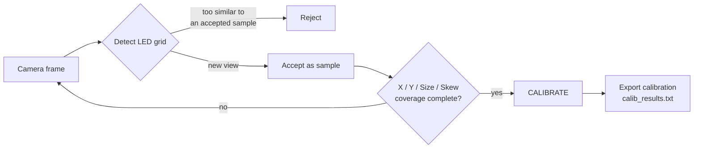

# UVDAR Calibrator

Calibrates UV-sensitive fisheye cameras (UVDAR) against a UV LED grid, using
[Scaramuzza's OCamCalib model](https://sites.google.com/site/scarabotix/ocamcalib-omnidirectional-camera-calibration-toolbox-for-matlab).
The result is a `calib_results.txt` in OCamCalib's text format.

<p align="center">
    
</p>

## Getting Started

Run this directly on the robot, with a display attached and the UV LED grid switched on:

```bash
xhost +local:root               # let the container open windows on your display
mkdir -p calibration_output     # the result is saved here

docker run -it --rm --network host --privileged -e DISPLAY \
  -e HOST_UID="$(id -u)" -e HOST_GID="$(id -g)" \
  -v /tmp/.X11-unix:/tmp/.X11-unix -v /dev:/dev \
  -v "$PWD/calibration_output:/calibration_output" \
  ghcr.io/fly4future/uvdar_calibrator:latest
```

The container detects the robot's camera, starts its driver and opens the calibration
window. If there are several cameras, it asks which one to calibrate.

Then:

1. **Move the LED grid around in front of the camera.** Frames are captured
   automatically. The "PUT LED GRID HERE" box on the image shows where to put the grid
   next, and the panel on the right says what is still missing. Cover the whole image:
   centre, edges and corners, near and far, tilted in different directions.
2. When it says **Ready to calibrate**, press **CALIBRATE**.
3. Press **Export calibration** and confirm the save dialog. The file goes to
   `calibration_output/` as `calib_results_<camera>.txt`.

Closing the window stops the container.

Some frames are rejected as too similar to ones already captured. That is expected: it
keeps the set varied. See [Using the GUI](doc/using-the-gui.md) for the details and
[Capturing Calibration Images](doc/capturing-images.md) for how to hold the grid.

## Development

Run your local checkout in the development container:

```bash
git clone git@github.com:fly4future/uvdar_calibrator.git
cd uvdar_calibrator
./docker-dev.sh          # build the calibrator from your checkout and start the wizard
./docker-dev.sh bash     # or open a shell in the container
```

The checkout is mounted into the container, so edits on the host are picked up on the
next start without rebuilding the image. Both images come from the same `Dockerfile`:
`docker-dev.sh` uses its `dev` stage, and the published image is the default (last)
stage, built by GitHub Actions on every push to `main`.

Tests run inside the dev container:

```bash
./docker-dev.sh bash
cd src/uvdar_calibrator && for t in test/test_*.py; do python3 "$t" || break; done
```

## Documentation

- [Using the GUI](doc/using-the-gui.md): the calibration window step by step,
  reprojection error, diagnostics, mirrored cameras, changing the LED grid
- [Capturing Calibration Images](doc/capturing-images.md): pattern requirements and
  what a good set of views looks like
- [Camera Setup and Docker](doc/docker.md): how the camera wizard picks a camera, its
  options, and what each `docker run` flag is for

## How It Works

Each camera frame goes through the same steps as ROS `camera_calibration`
(image_pipeline): the LED grid is detected, the view is reduced to four numbers
(X/Y position, size, skew), and the frame is kept as a sample only if it differs
enough from every sample already kept. Calibration is allowed once the samples
cover enough of each of the four ranges.


