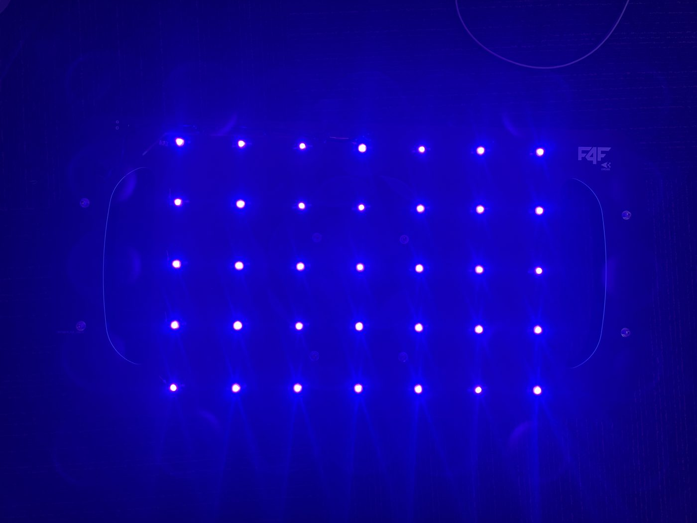
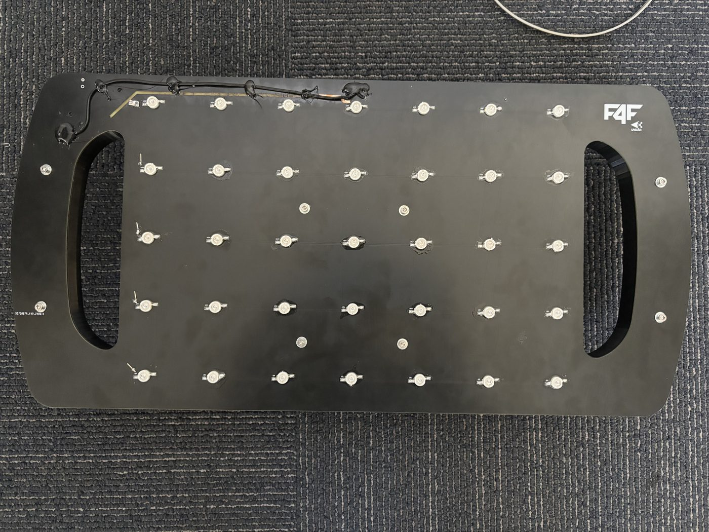
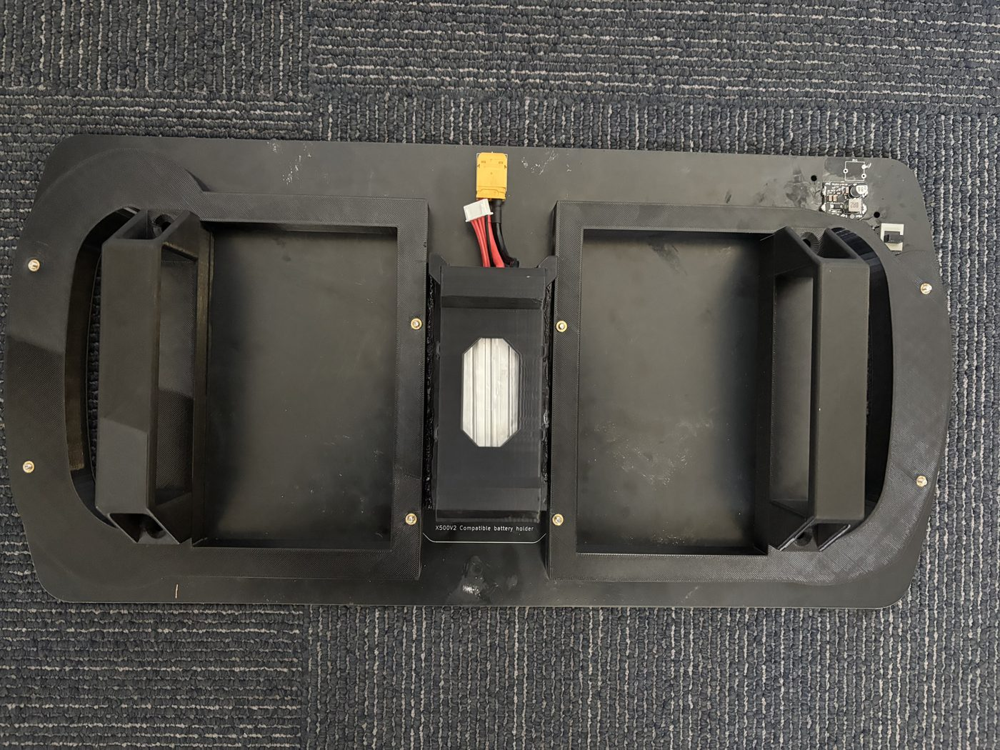
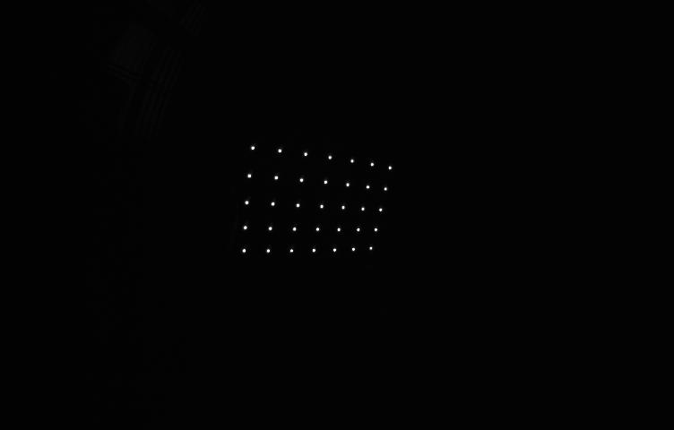
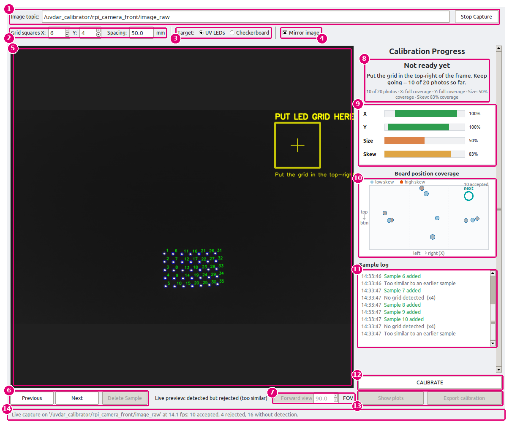
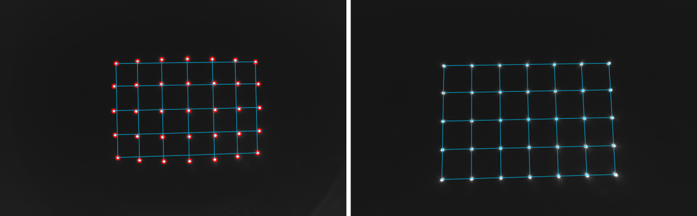
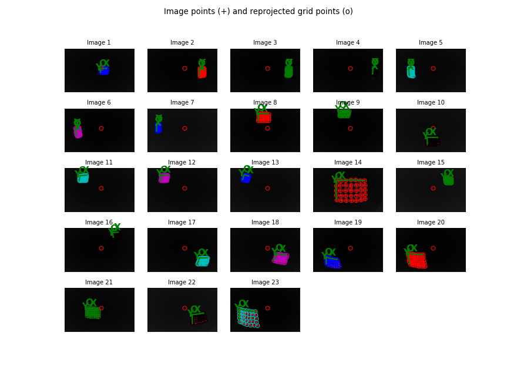
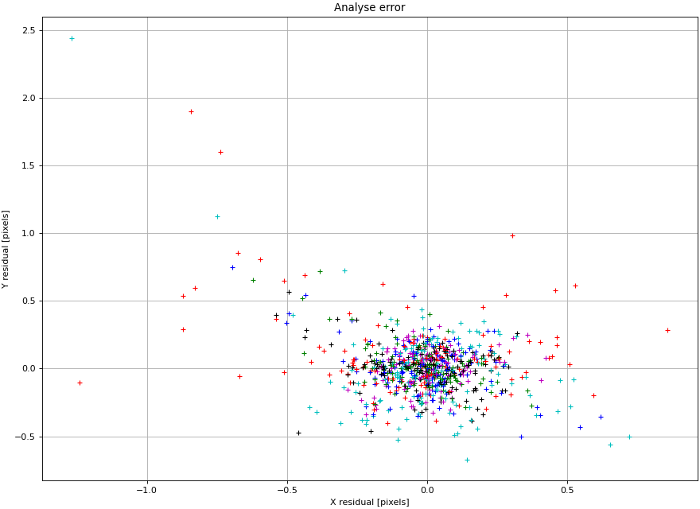
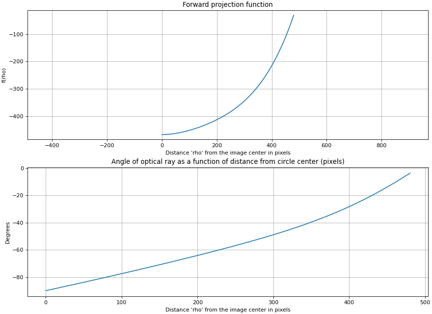
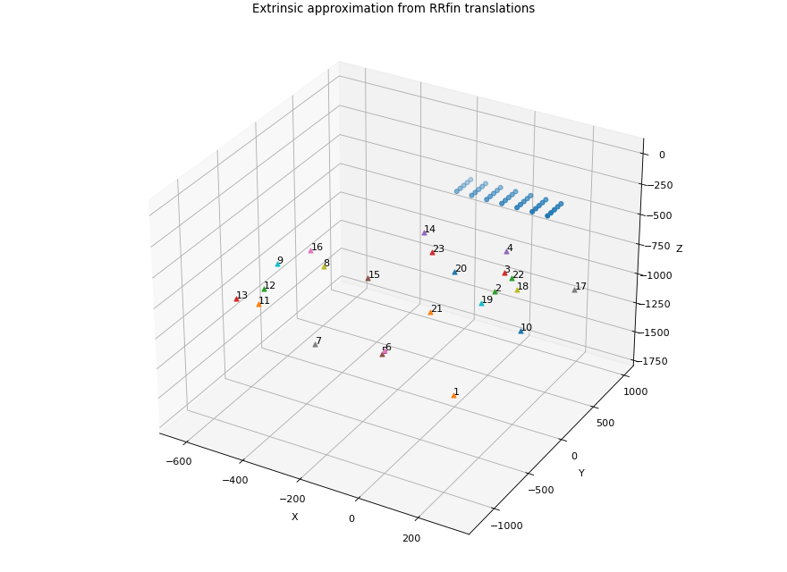

# UVDAR Calibrator

Calibrates UV-sensitive fisheye cameras (UVDAR) against a UV LED grid, using
[Scaramuzza's OCamCalib model](https://sites.google.com/site/scarabotix/ocamcalib-omnidirectional-camera-calibration-toolbox-for-matlab).
The result is a `calib_results.txt` in OCamCalib's text format.

<p align="center">
    
</p>

- [Quick start](#quick-start)
- [The calibration target](#the-calibration-target)
- [Capturing a good set of views](#capturing-a-good-set-of-views)
- [The calibration window](#the-calibration-window)
- [Checking the result](#checking-the-result)
- [Running in Docker](#running-in-docker)
- [Development](#development)

## Quick start

Run this directly on the robot with a display attached:

```bash
xhost +local:root               # let the container open GUI windows
mkdir -p calibration_output     # the result is saved here

docker run -it --rm --network host --privileged -e DISPLAY \
  -e HOST_UID="$(id -u)" -e HOST_GID="$(id -g)" \
  -v /tmp/.X11-unix:/tmp/.X11-unix -v /dev:/dev \
  -v "$PWD/calibration_output:/calibration_output" \
  ghcr.io/fly4future/uvdar_calibrator:latest
```

The container detects the robot's camera, starts its driver and opens the calibration
window. If there are several cameras, it asks which one to calibrate.

1. Move the LED grid around in front of the camera. Frames are captured automatically,
   and a guide shows where to put the grid next (the part of the image with the fewest
   samples).
2. When you have collected enough samples, the window says **Ready to calibrate**.
3. Press **CALIBRATE** and wait a few seconds for the calibration to be computed.
4. Press **Export calibration** to save the calibration file. It is saved to
   `calibration_output/` as `calib_results_<camera>.txt`; the folder is mounted into
   the container, so the file stays on the robot after the container exits.
5. Close the window to exit the calibrator. To calibrate another camera, run the
   `docker run` command again.

## The calibration target

The target is a non-square grid of UV LEDs emitting around 395 nm. The LEDs play the
role of a checkerboard's inner corners. The default grid is 6 x 4 squares (7 x 5 LEDs)
with 50 mm spacing; other sizes are set in the window.

<p align="center">
    
    
    
</p>

Through a correctly built UV camera the grid shows up as small, distinct bright dots:

<p align="center">
    
</p>

A printed checkerboard works too (**Target**, item 3 in
[the calibration window](#the-calibration-window)).

## Capturing a good set of views

The calibration is only as good as the variety of views. Aim for views where:

- the whole grid is visible and every LED is a small, unsaturated dot;
- the grid appears in every part of the image: centre, edges and corners;
- the grid is at different distances, from close up (filling much of the image) to far;
- the grid is tilted in different directions.

Hold the grid still for a moment in each position so a sharp frame is captured.

Frames that look like one already collected (same place, size and tilt) are rejected.
That is intended: it keeps the set varied instead of large. The window says it is ready
to calibrate once all four coverage bars (item 9 below) are full and there are enough
samples.

## The calibration window



1. **Image topic** and **Start/Stop Capture**. The wizard fills in the camera's topic;
   capture stops automatically while calibrating.
2. **Grid size and LED spacing.** Changes apply when you press Enter or leave the field.
   Changing the number of squares drops the samples collected so far (they belong to
   another grid); changing only the spacing keeps them.
3. **Target**: the UV LED grid, or a printed checkerboard whose inner corners match the
   grid size (a 6 x 4 grid is a checkerboard of 7 x 5 squares). Switching drops the
   samples collected so far.
4. **Mirror image** (on by default) flips the camera image left-right, for drivers that
   deliver a mirrored image. Switching it drops the samples collected so far.
5. **Live image** with the detected LEDs numbered and the **PUT LED GRID HERE** guide.
6. **Previous / Next** browse the accepted samples; **Delete Sample** removes a bad one
   (while capture is stopped).
7. **Forward view**, after calibrating; see [Forward view](#forward-view).
8. **Status**: whether you can calibrate yet and what to do next.
9. **Coverage bars**: how much of the needed range the samples cover, left-right (X),
   up-down (Y), in size (distance) and in tilt (Skew). Green when full.
10. **Coverage map**: where the samples are in the image; bigger dots are closer views,
    orange ones more tilted. The ring marks where the guide wants the next one.
11. **Sample log**: every processed frame, as added, too similar to an earlier sample,
    or no grid detected (repeats are counted on one line).
12. **CALIBRATE** computes the calibration, from a few seconds to about a minute
    depending on the number of samples and the CPU. Calibrating before the window says
    ready asks for confirmation; treat that result as preliminary.
13. **Show plots** opens the [diagnostic plots](#diagnostic-plots); **Export
    calibration** saves the calibration file.
14. **Status line**: capture state, camera frame rate and sample counts.

With a libcamera camera, a **Camera exposure** card appears below the status (8): a
logarithmic slider and a value box in microseconds, applied to the running camera when
you let go of the slider (it needs the patched driver the image builds). The value and
the slider's min/max are remembered between runs.

## Checking the result

A good calibration has all of: full coverage before calibrating, a low reprojection
error with no outlier sample, straight lines in the forward view, and an image center
near the middle of the sensor (shown after CALIBRATE).

### Reprojection error

After solving, the model knows the lens and where the grid was in each sample, so it can
predict where every LED should appear. The reprojection error is the distance in pixels
between that prediction and where the LED was actually detected, averaged over all LEDs.

| Mean error | Meaning |
| --- | --- |
| below 0.3 px | very good |
| 0.3 – 0.5 px | good |
| 0.5 – 1 px | usable; look for a bad sample |
| above 1 px | something is wrong: a bad sample, the wrong grid size, or a mirrored camera without Mirror image |

A low error only says the model fits the samples you gave it. If they all show the grid
in the middle, the model can still be wrong near the edges, which is why coverage comes
first.

### Forward view

After calibrating, **Forward view** shows the image the way an ordinary (non-fisheye)
camera would see it, using the solved model. Straight edges should look straight: below,
the grid's rows and columns bow in the raw image (left) and are straight in the forward
view (right).



The view covers the central 90° by default (the FOV box widens it). It can never show
the whole fisheye image: a perspective view cannot reach 90° off the camera axis.

### Diagnostic plots

**Show plots** opens a window with one tab per plot. For the background, see the
[OCamCalib documentation](https://sites.google.com/site/scarabotix/ocamcalib-omnidirectional-camera-calibration-toolbox-for-matlab).

**Reprojection**: each sample, with the detected LEDs (`+`) and where the model puts
them (`o`). They should sit on top of each other; a sample where they drift apart is
bad and can be deleted (item 6) before calibrating again.



**Error analysis**: the error of every LED, coloured by sample. Expect a tight cluster
around zero; a group of points far out belongs to one bad sample.



**Projection function**: the solved lens polynomial (top) and the angle of the incoming
ray against the distance from the image center (bottom). Both should be smooth curves
without wiggles or turn-backs.



**Extrinsics**: the grid's LEDs (dots) and, for every sample, where the grid was
relative to the camera (numbered triangles, in mm). They should spread out in all
directions and over a range of distances; a point far away from the rest is a failed
sample.



## Running in Docker

The image contains ROS 2, the camera drivers and the calibrator. On start, the camera
wizard detects the connected cameras, writes the driver configuration from the
templates in `config/<camera>/`, and starts a tmux session with the driver and the
calibration window. Closing the window ends the session and the container.

What the `docker run` flags in the [quick start](#quick-start) are for:

- `--network host`: reaches network cameras (Basler) and makes the ROS topics
  visible from the host.
- `--privileged` and `-v /dev:/dev`: access to the camera devices (USB, video4linux,
  media, I2C) and to `/sys`, which the wizard reads to detect the camera.
- `-e DISPLAY` and `-v /tmp/.X11-unix:/tmp/.X11-unix`: show the window on the robot's
  display (together with `xhost +local:root`).
- `-v "$PWD/calibration_output:/calibration_output"`: where the exported files end up.
- `-e HOST_UID=... -e HOST_GID=...`: the user that owns the exported files instead of
  root.

The image rebuilds the libcamera driver with a small patch
(`patches/0001-libcamera-expose-us.patch`) that adds the `~/expose_us` topic, so the
exposure slider works without restarting the stream.

The wizard detects:

- **libcamera** sensors from the device tree: a sensor is a node that is both an I2C
  client and a media/video device;
- **Basler** cameras through `pypylon`, by serial number.

## Development

Run your local checkout in the development container:

```bash
git clone git@github.com:fly4future/uvdar_calibrator.git
cd uvdar_calibrator
./docker-dev.sh          # build the calibrator from your checkout and start the wizard
./docker-dev.sh bash     # or open a shell in the container
```

The checkout is mounted into the container, so changes are picked up on the next start
without rebuilding the image. Tests run inside the dev container:

```bash
./docker-dev.sh bash
cd src/uvdar_calibrator && for t in test/test_*.py; do python3 "$t" || break; done
```

### Images

There is one `Dockerfile` with two targets that share every layer up to the
calibrator's own source:

- the default (last) stage copies the source in and builds it. GitHub Actions
  publishes it as `ghcr.io/fly4future/uvdar_calibrator` on every push to `main`. To
  build it locally: `docker build -t uvdar_calibrator .`
- the `dev` stage, used by `./docker-dev.sh`, mounts the code at
  `/ros2_ws/src/uvdar_calibrator` and builds it on start.

### Adding support for another camera

1. Install or build the camera driver in the `Dockerfile`.
2. Add template configs and a tmuxinator session file to `config/<camera>/`. They hold
   "good enough" settings for calibration (resolution, frame rate, exposure, ...) and
   placeholders for whatever depends on the specific camera, such as its identifier.
   The wizard fills in the placeholders and starts the session with the result.
3. Teach the wizard (`uvdar_calibrator/apps/camera_wizard.py`) to find the camera and
   fill in its templates.
