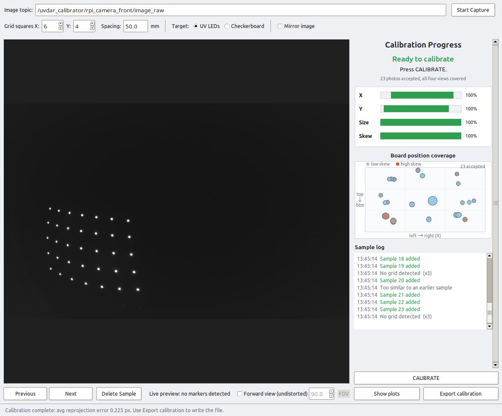

# Using the GUI

The window opens once the camera wizard has started the driver (see the
[README](../README.md#getting-started)). It subscribes to the camera's image topic and
captures automatically.

## Step by Step

1. Move the UV LED grid around in front of the camera. Frames are processed at about
   2 per second; each is either **accepted** as a sample, **rejected** because it is
   too similar to an accepted sample, or has no grid detected.
2. Follow the guidance: the "PUT LED GRID HERE" box on the live image and the text at
   the top of the sidebar say where to put the grid next and what is still missing.
3. Once the sidebar says **Ready to calibrate**, press **CALIBRATE**. Capture pauses
   while it solves. (You can also calibrate earlier after confirming a warning, but
   treat the result as preliminary.)
4. Review the reprojection error shown after the solve. Below 1 px is good; 0.3-0.5 px
   is typical.
5. Press **SAVE / EXPORT**. The save dialog suggests `calib_results_<camera>.txt` in
   `/calibration_output`, which is the `calibration_output/` folder on the host. That
   text file is the only output.

**Dev mode** (the **Dev** button in the bottom-right corner, or Ctrl+D) shows the
diagnostic panels that are hidden by default: the X / Y / Size / Skew range bars, the
coverage graph, the sample log, Previous/Next/Delete for browsing accepted samples
(while capture is stopped), and the forward view below.

Each range bar shows the span of that parameter the accepted samples cover; it turns
green when the span is wide enough. Readiness needs all four bars full **and** at least
20 accepted samples.

Important: **some photos being rejected is normal and correct.** Two photos
of the grid in nearly the same position, size, and tilt add no new
information, so only the first one is kept. The goal is not to collect many
images — it is to collect images that cover the full camera field of view
with varied positions, sizes, and tilts.



## The Forward View

Once calibrated, the **Forward view (undistorted)** checkbox (dev mode) re-renders the
image the way an ordinary perspective camera would have seen it, using the model just
solved. This is a sanity check: the fisheye bows the grid's rows and columns, and a
correct model straightens them again, so the LED grid should look like a clean
perspective rectangle.

The view shows the central 90° and crops the rest, on purpose. A perspective
projection cannot represent a ray at or past 90° from the optical axis, so a fisheye's
outer rim is unreachable at *any* setting, and widening the view shrinks the pattern
you are trying to inspect.

## What Reprojection Error Means

Reprojection error is the difference between the detected UV marker location and the
model-predicted UV marker location. It is **not** the distance from the image center.

The error is computed approximately as:

```text
error = sqrt((detected_row - projected_row)^2 + (detected_col - projected_col)^2)
```

For each image, the displayed error is the average error across all detected UV
markers in that image. The center-to-point distance is useful for coverage and
field-of-view analysis, but it is not calibration error.

## The Diagnostics Window

With **Show diagnostics plots after calibration** ticked (Advanced Settings),
CALIBRATE opens a single window with one tab per diagnostic. It does not block the
GUI. Each tab has the standard matplotlib toolbar, so use the
magnifier to zoom; with 20+ samples the reprojection panels are necessarily small.

| Tab | What it shows | What to look for |
| --- | --- | --- |
| **Reprojection** | One panel per accepted sample: detected markers (`+`) against the model's reprojected grid (`o`) | The two should sit on top of each other. A panel where they drift apart is a bad sample. |
| **Error analysis** | Reprojection error of every marker, per sample | A tight cluster near the origin. A sample that fans out wide is dragging the solve. |
| **Projection function** | The solved polynomial: image radius vs ray angle | A smooth monotonic curve. Wiggles or a fold-back mean the polynomial is overfitted. |
| **Extrinsics** | 3D scatter of where the board was for each sample, in mm relative to the camera | Spread in all directions and a wide range of distances. Points clustered at one distance mean your Size variety is not real; a point behind the camera or absurdly far away is a failed pose that will degrade the whole solve. |

The console also prints the per-sample and average reprojection error alongside
these, whether or not you ask for the plots.

## Changing the LED Grid

The `LED grid: 6 x 4, 50 mm spacing (change)` button opens the X/Y square counts and
the LED spacing. Changes apply as soon as you press Enter, leave the field, or use a
spinbox arrow. Changing a count changes the point grid the detector looks for, so the
samples captured for the old grid are dropped and capture starts over. Changing only
the spacing keeps the samples and asks you to press CALIBRATE again.

## Mirrored Cameras

Some drivers deliver a left-right flipped image. **Mirror incoming frames** in
Advanced Settings flips the frames back before the preview, the detection and the
saved model see them. Switching it drops the samples captured so far, since they
describe the other orientation.

## Advanced Settings

Shows the sample-selection settings the session was started with (read-only), plus
the switches for the slow MATLAB-style center search, the diagnostics plots and
mirroring.
